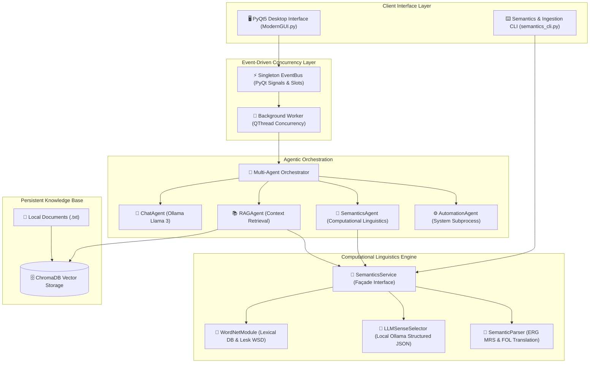

# NexusAI – Advanced Multi-Agent Assistant & Computational Linguistics Engine

<div align="center">

[](https://github.com/parulmishra321/NexusAI/releases)
[-brightgreen.svg?style=for-the-badge)](#diagnostic-tests)
[](https://www.python.org/)
[](https://nltk.org/howto/wordnet.html)
[](https://ollama.com/)
[](LICENSE)

<p align="center">
  <b>A modular, offline-first desktop AI assistant combining Multi-Agent Orchestration, Local Vector RAG, and Formal Computational Semantics.</b>
</p>

</div>

---

### ⚡ 1-Line Quickstart

Clone and run the complete automated linguistics and semantic processing verification suite:

```bash
python semantics_cli.py --demo
```

---

## 🏛️ End-to-End System Architecture

NexusAI follows a hexagonal, event-driven architecture that decouples user interfaces (PyQt5 GUI and CLI) from asynchronous execution workers, agent orchestrators, and local inference engines.



---

## 🔬 Computational Linguistics & Formal Semantics

NexusAI integrates formal semantic processing and lexical disambiguation directly into the assistant runtime:

| Capability | Module | Core Algorithm / Framework | Output Format | Offline Ready |
| :--- | :--- | :--- | :--- | :---: |
| **Synset Retrieval** | `WordNetModule` | NLTK WordNet 3.0 Hierarchy | Structured Dict (Lemmas, Defs, Hypernyms) | ✅ Yes |
| **Algorithmic WSD** | `WordNetModule` | Simplified & Extended Lesk / Wu-Palmer | Scored Synset Candidate with Overlap Tokens | ✅ Yes |
| **LLM Sense Selection** | `LLMSenseSelector` | Local Ollama Inference (`llama3`) | Strict Validated JSON Schema | ✅ Yes |
| **Semantic Parsing** | `SemanticParser` | English Resource Grammar (ERG) MRS | DELPH-IN ASCII Representation | ✅ Yes |
| **Logic Translation** | `SemanticParser` | Quantifier Scoping Resolution | First-Order Logic (Unicode & ASCII) | ✅ Yes |
| **RAG Query Expansion** | `SemanticsService` | Contextual Synset & Synonym Expansion | Augmented Vector Database Query | ✅ Yes |

---

## 🖥️ Visual Terminal Showcase

### 1. English Resource Grammar (ERG) MRS to First-Order Logic (FOL)
```text
$ python semantics_cli.py --fol "The black cat chased a mouse"

[ LTOP: h0
  INDEX: e2 [ e SF: prop TENSE: pres MOOD: indicative ]
  RELS: <
    [ _the_q_rel LBL: h3 ARG0: x3 RSTR: h4 BODY: h5 ]
    [ _black_a_1_rel LBL: h6 ARG0: e4 ARG1: x3 ]
    [ _cat_n_1_rel LBL: h6 ARG0: x3 ]
    [ _a_q_rel LBL: h7 ARG0: x5 RSTR: h8 BODY: h9 ]
    [ _mouse_n_1_rel LBL: h10 ARG0: x5 ]
    [ _chase_v_1_rel LBL: h1 ARG0: e2 ARG1: x3 ARG2: x5 ]
  >
  HCONS: < h0 =q h1  h4 =q h6  h8 =q h10 >
]

FOL Formula (Unicode): ∃x3. (black(x3) ∧ cat(x3) ∧ ∃x5. (mouse(x5) ∧ ∃e2. (chase(e2, x3, x5))))
FOL Formula (ASCII):   exists x3. (black(x3) & cat(x3) & exists x5. (mouse(x5) & exists e2. (chase(e2, x3, x5))))
Main MRS Index:        e2

Scoping & Quantifier Resolution Steps:
  • 1. Core event relation: chase(e2, x3, x5)
  • 2. Event existential closure: ∃e2. (chase(e2, x3, x5))
  • 3. Existential quantification over x5: ∃x5. (mouse(x5) ∧ ∃e2. (chase(e2, x3, x5)))
  • 4. Existential quantification over x3: ∃x3. (black(x3) ∧ cat(x3) ∧ ∃x5. (mouse(x5) ∧ ∃e2. (chase(e2, x3, x5))))
```

### 2. Ollama LLM Structured JSON Sense Disambiguation
```json
$ python semantics_cli.py --llm-wsd "The commercial bank approved the mortgage loan" --target-words bank

{
  "sentence": "The commercial bank approved the mortgage loan.",
  "model_used": "llama3",
  "disambiguations": [
    {
      "word": "bank",
      "synset_id": "depository_financial_institution.n.01",
      "sense_number": 1,
      "pos": "n",
      "definition": "a financial institution that accepts deposits and channels the money into lending activities",
      "confidence": 0.95,
      "justification": "Sentence context specifies commercial lending and mortgages, matching the financial institution sense.",
      "method": "llm_ollama"
    }
  ]
}
```

---

## 🤖 Multi-Agent Ecosystem

| Agent | Responsibility | Primary Engine | Trigger Keywords |
| :--- | :--- | :--- | :--- |
| **`SemanticsAgent`** | WSD, synsets, ERG MRS parsing, FOL logic conversion | NLTK WordNet + Ollama + SemanticParser | `synset`, `disambiguate`, `mrs`, `fol`, `logic` |
| **`RAGAgent`** | Grounded question-answering over local documents | ChromaDB + Ollama Embeddings + SemanticsService | `my notes`, `document`, `read file` |
| **`ChatAgent`** | General conversational intelligence & reasoning | Local Ollama (`llama3`) / Cloud Groq | Default conversation |
| **`AutomationAgent`** | Host operating system automation | Native Python `subprocess` | `open`, `play`, `close` |
| **`OfflineAgent`** | Autonomous offline fallback runner | Local Ollama (`llama3`) | Network disconnection fallback |

---

## 📂 Project Structure

```text
NexusAI/
├── Backend/
│   ├── Core/
│   │   ├── Agents/                 # Multi-Agent subsystem
│   │   │   ├── BaseAgent.py        # Abstract base class
│   │   │   ├── Orchestrator.py     # Central routing brain
│   │   │   ├── SemanticsAgent.py   # Linguistics & semantic processing
│   │   │   ├── ChatAgent.py        # Conversational agent
│   │   │   ├── RAGAgent.py         # Retrieval Augmented Generation
│   │   │   ├── AutomationAgent.py  # System automation
│   │   │   └── OfflineAgent.py     # Local fallback agent
│   │   ├── Memory/                 # VectorDB & document ingestion
│   │   │   ├── VectorDB.py         # ChromaDB client interface
│   │   │   └── Ingestion.py        # Document parsing pipeline
│   │   ├── Semantics/              # Computational Linguistics Engine
│   │   │   ├── WordNetModule.py    # NLTK WordNet & Lesk WSD
│   │   │   ├── LLMSenseSelector.py # Ollama structured JSON WSD
│   │   │   ├── SemanticParser.py   # ERG MRS & First-Order Logic
│   │   │   └── SemanticsService.py # Façade & RAG query enrichment
│   │   ├── EventBus.py             # Singleton event bus (Signals/Slots)
│   │   └── Worker.py               # QThread background execution worker
├── Frontend/
│   ├── Graphics/                   # UI assets, icons, and animations
│   └── ModernGUI.py                # PyQt5 Desktop Dark Mode UI
├── Data/
│   ├── Documents/                  # Target folder for user notes (.txt)
│   └── VectorDB/                   # ChromaDB persistent storage
├── tests/
│   └── test_semantics.py          # 24 Unit & Integration test suite
├── Main.py                         # Desktop application entry point
├── ingest.py                       # CLI document ingestion script
├── semantics_cli.py                # Computational semantics CLI tool
├── setup.bat                       # Automated 1-click Windows installer
├── Requirements.txt                # Project dependencies
└── LICENSE                         # MIT Open-Source License
```

---

## 🚀 Setup & Installation

### 1. Prerequisites
- **Python**: 3.10 or higher
- **Ollama**: Download and install from [ollama.com](https://ollama.com/)
- Pull the local model:
  ```bash
  ollama pull llama3
  ```

### 2. Setup Environment
```bash
# Clone the repository
git clone https://github.com/parulmishra321/NexusAI.git
cd NexusAI

# Run automated setup script (Windows)
setup.bat

# Or manual installation
python -m venv .venv
.venv\Scripts\activate
pip install -r Requirements.txt
```

### 3. Launching Application
```bash
# Start Desktop GUI Assistant
python Main.py

# Run Computational Linguistics CLI
python semantics_cli.py --demo

# Run Full Test Suite
python -m unittest tests/test_semantics.py -v
```

---

<a id="diagnostic-tests"></a>
## 🧪 Diagnostic Tests

NexusAI includes an automated test suite verifying lexical retrieval, WSD, ERG MRS parsing, FOL translation, and multi-agent routing:

```bash
# Execute full test suite
python -m unittest tests/test_semantics.py -v
```

| Test Suite | Target Component | Test Cases | Status |
| :--- | :--- | :---: | :---: |
| `TestWordNetModule` | [`WordNetModule.py`](Backend/Core/Semantics/WordNetModule.py) | 8 | ✅ Passing |
| `TestLLMSenseSelector` | [`LLMSenseSelector.py`](Backend/Core/Semantics/LLMSenseSelector.py) | 3 | ✅ Passing |
| `TestSemanticParser` | [`SemanticParser.py`](Backend/Core/Semantics/SemanticParser.py) | 5 | ✅ Passing |
| `TestSemanticsService` | [`SemanticsService.py`](Backend/Core/Semantics/SemanticsService.py) | 3 | ✅ Passing |
| `TestAgentAndPipelineIntegration` | Orchestrator, SemanticsAgent, RAGAgent | 5 | ✅ Passing |
| **Total** | **All Verification Suites** | **24** | **100% Pass** |

---

## 📄 License & Attribution

This project is licensed under the **MIT License** - see the [`LICENSE`](LICENSE) file for details.

Developed with ❤️ by **Parul Mishra**  
- 🔗 **LinkedIn**: [linkedin.com/in/parul-mishra-576a95100](https://www.linkedin.com/in/parul-mishra-576a95100/)  
- 🐙 **GitHub**: [github.com/parulmishra321](https://github.com/parulmishra321)  
- 📧 **Email**: [parul95@hotmail.com](mailto:parul95@hotmail.com)
